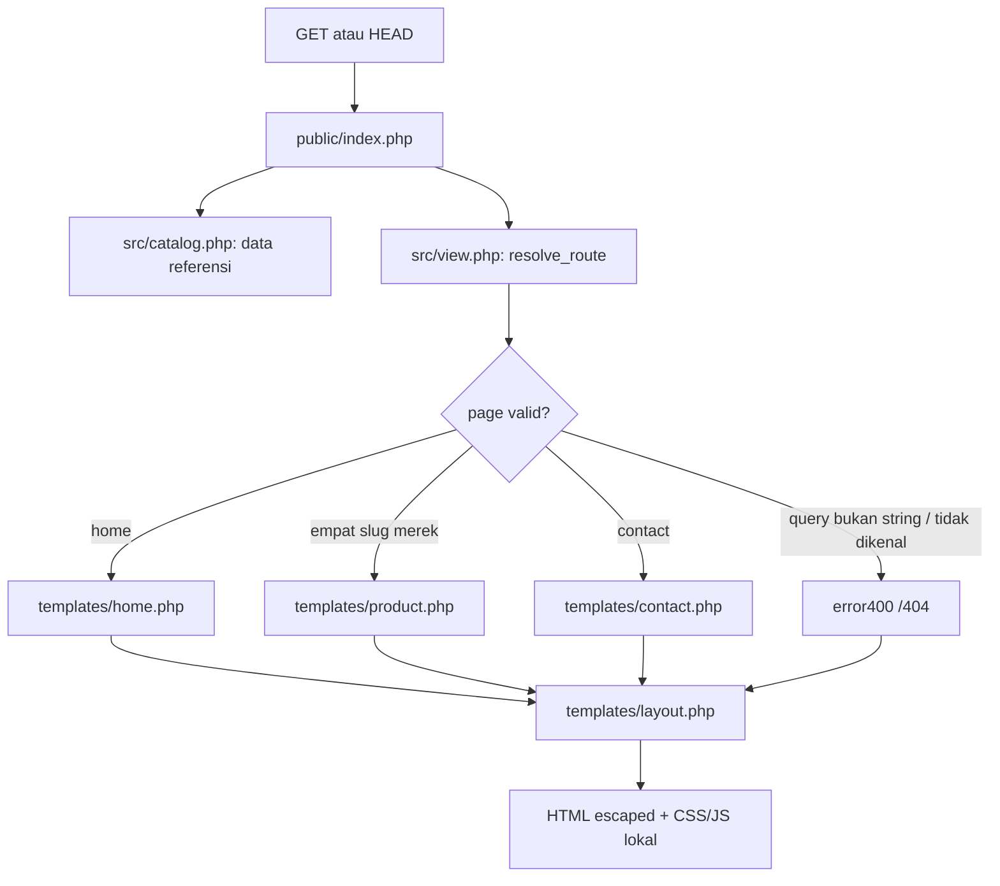
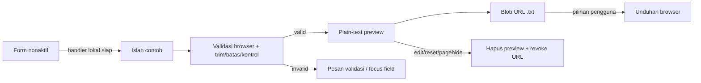

# Alur kode Hospitech brochure

## Request halaman

[public/index.php](public/index.php) menerima `GET`/`HEAD`, memuat katalog dan memilih template. `HEAD` memakai status/header yang sama tanpa body. Method lain mendapat405 dan `Allow: GET, HEAD`. Query `page` bertipe array/null/bukan string mendapat400; slug string yang tidak ada mendapat404. Nilai query yang tidak valid tidak ditampilkan ulang.

Path front controller adalah `/` atau `/index.php`; path lain yang diteruskan server ke controller mendapat404. Aset dan link utama memakai path dari root sehingga halaman error tetap dapat membuka Home dan stylesheet yang benar.

[resolve_route](src/view.php) memilih halaman dari allowlist. Nama template tidak berasal langsung dari query. `render_template` mempunyai allowlist tersendiri dan membersihkan output buffer jika render gagal. `e()` menggunakan `htmlspecialchars` dengan quote escaping dan substitusi UTF-8 tidak valid.

`src/`, `templates/` dan `tests/` berada di luar document root `public/`. Controller tidak menerima form kontak, melakukan upload, membuka sesi atau mengubah data. Header CSP memuat aset hanya dari origin lokal, memblokir koneksi JavaScript dan pengiriman form; header tersebut tidak menggantikan pemeriksaan input atau menjadikan demo ini layanan produksi.

## Konten dan tampilan

[src/catalog.php](src/catalog.php) mempertahankan array merek/summary/fitur/brochure/contact dari sumber lokal. `[products][slug]` menjadi satu halaman produk. Detail bisnis ditampilkan melalui [templates/contact.php](templates/contact.php) sebagai teks referensi yang tidak aktif.

[templates/form.php](templates/form.php) dipakai halaman produk dan kontak. Produk mengirim slug sendiri sebagai pilihan awal; kontak memilih general enquiry. [templates/illustration.php](templates/illustration.php) adalah gambar konseptual berlabel, bukan sumber data pasien/perangkat.

[templates/layout.php](templates/layout.php) menyediakan navigasi native `
/
`. [site.js](public/assets/site.js) hanya menambahkan Escape untuk menutup disclosure/mengembalikan focus dan klik luar untuk menutupnya. Navigasi katalog tetap bekerja tanpa JavaScript.

Warna/layout berasal dari [site.css](public/assets/site.css), tanpa CDN, font eksternal atau compiler. Tema merek memakai pemetaan slug tetap di CSS; nilai query tidak ditulis menjadi aturan CSS.

## Lifecycle draft lokal

JavaScript memasang handler sebelum mengaktifkan fieldset. Submit dicegah di browser; isian dinormalisasi, wajib/format email diperiksa, panjang dibatasi dan karakter kontrol yang tidak sesuai ditolak. Pilihan produk diambil dari option lokal, bukan URL eksternal.

Draft disusun sebagai string dan diberikan melalui `textContent` ke preview. Blob `text/plain;charset=utf-8` menyediakan tautan unduhan; file tidak diunduh otomatis dan tidak ada status “pesan terkirim”. Edit, reset dan `pagehide` mencabut hanya Blob URL milik form tersebut. Kegagalan pembuatan Blob menampilkan pesan dan menghapus tautan yang tidak bisa dipakai.

Tidak ada `fetch`, XHR, SMTP, WhatsApp API, cookie, localStorage, sessionStorage atau backend penyimpanan. File hasil unduhan berada di luar lifecycle halaman dan dikelola pengguna/browser.

## Pemeriksaan

[tests/run.php](tests/run.php) memeriksa isi empat merek/29 fitur, render fitur/overview, pilihan produk pada form, route dan status error, escaping, pemilihan template dan resource lokal. File PHP juga diparse melalui tokenizer PHP.

Tes source tersebut memeriksa kontrak kode. Verifikasi terpisah menjalankan aplikasi PHP aktual:26 pemeriksaan HTTP dan77 pemeriksaan Chrome lulus, termasuk unduhan draft yang byte-nya cocok dengan pratinjau, tidak adanya pengiriman form, validasi keyboard/no-JS, pemulihan Blob, keenam halaman pada lima lebar layar dan skala teks200%. Screenshot README berasal dari run itu; input draftnya sintetis. Tidak ada backend pengiriman, database atau dependency browser yang diperlukan untuk menjalankan aplikasi.
