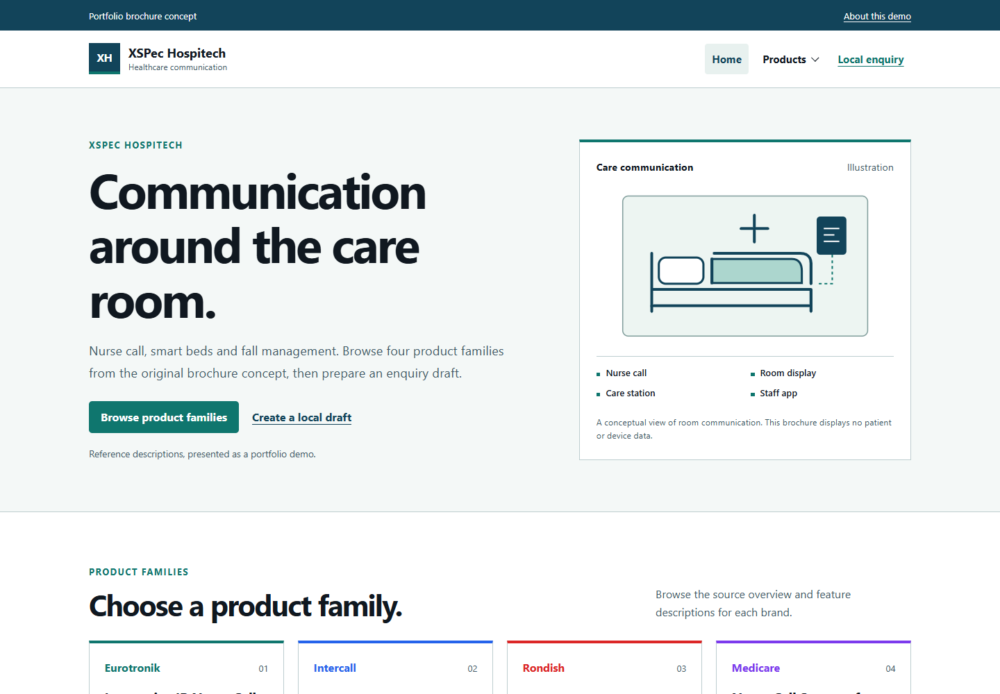
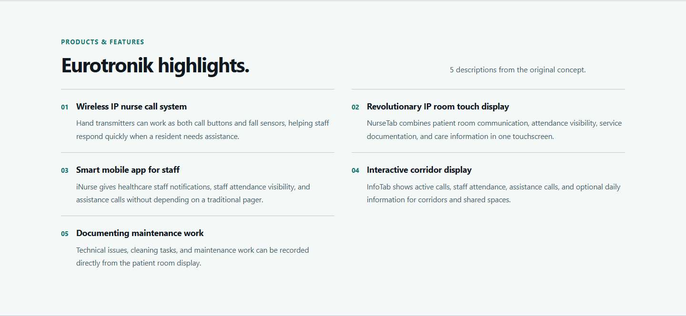
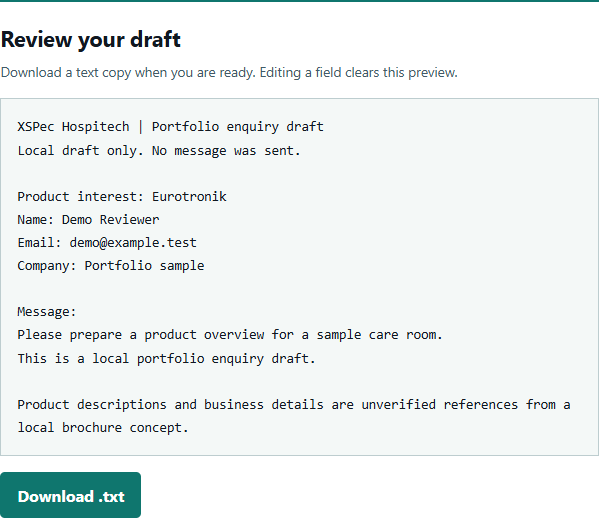

# Hospitech brochure

Brosur PHP untuk empat merek dalam konsep XSPec Hospitech: Eurotronik, Intercall, Rondish dan Medicare. Halaman produk mempertahankan **29 deskripsi fitur dari sumber lokal**. Formulir membuat pratinjau enquiry dan file teks yang bisa diunduh.

Ini proyek portfolio. Ilustrasi ruang perawatan memakai gambar konseptual, sementara deskripsi produk dan detail bisnis merupakan referensi sumber yang belum diverifikasi. Aplikasi ini bukan sistem pemantauan pasien dan tidak mengirim pesan ke perusahaan. Asal konten dijelaskan di [NOTICE.md](NOTICE.md).

## Tampilan aplikasi



Beranda PHP yang dijalankan di Chrome pada viewport1440×1000. Gambar ruang perawatan diberi label ilustrasi.



Bagian fitur Eurotronik mempertahankan lima deskripsi asli sebagai referensi, dengan layout yang menyesuaikan layar.



Pratinjau draft lokal dengan input sintetis. Tautan unduhan menghasilkan berkas teks; tidak ada pesan yang dikirim.

## Menjalankan

Gunakan PHP CLI **8.3 atau lebih baru**:

```powershell
git clone https://github.com/zalamanga/hospitech-brochure.git
cd hospitech-brochure
php -n -S 127.0.0.1:18816 -t public
```

Buka [http://127.0.0.1:18816](http://127.0.0.1:18816). Hentikan server dengan `Ctrl+C`. Opsi `-n` menjalankan PHP tanpa konfigurasi `php.ini` mesin; proyek memakai fasilitas standar PHP. Tidak ada langkah install dependency atau setup database.

Document root harus **public/**. Data katalog, template dan tes berada di luar folder tersebut. Server bawaan PHP digunakan untuk pengembangan lokal.

## Halaman dan konten

| Halaman | URL | Isi |
|---|---|---|
| Beranda | `/` | Empat keluarga produk dan ilustrasi komunikasi ruang perawatan |
| Eurotronik | `/?page=eurotronik` | NurseCare, overview dan 5 deskripsi fitur |
| Intercall | `/?page=intercall` | Touch Series, overview dan 15 deskripsi fitur |
| Rondish | `/?page=rondish` | SmartBeds, overview dan 5 deskripsi fitur |
| Medicare | `/?page=medicare` | Nurse Call Systems, overview dan 4 deskripsi fitur |
| Enquiry lokal | `/?page=contact` | Detail bisnis sebagai referensi dan pembuat draft |

Nama brosur pabrikan dipertahankan sebagai referensi. Versi ini tidak menyertakan file PDF pabrikan; tombol produk membuka deskripsi atau pembuat draft. Email, nomor telepon dan WhatsApp pada halaman kontak ditampilkan sebagai teks, dengan keterangan bahwa detailnya belum diverifikasi.

## Membuat draft

1. Buka **Local enquiry**, atau **Draft an enquiry** dari halaman produk. Produk yang sedang dibaca terpilih otomatis.
2. Isi contoh nama, email, perusahaan opsional dan pesan. Centang pernyataan bahwa draft hanya dibuat lokal, lalu pilih **Create draft**.
3. Periksa teks yang muncul. Pilih **Download .txt** untuk menyimpan salinan melalui browser.

Mengubah isian menghapus pratinjau dan tautan unduhan lama. **Reset** membersihkan form serta draft dan mengembalikan pilihan produk awal. Form memerlukan JavaScript; ketika JavaScript tidak tersedia, kontrol tetap nonaktif dengan penjelasan yang terlihat.

| Isian | Batas |
|---|---|
| Nama | Wajib, maksimal 100 karakter |
| Email | Wajib, format email browser, maksimal 254 karakter |
| Perusahaan | Opsional, maksimal 120 karakter |
| Pesan | Wajib, maksimal 2000 karakter; baris baru dipertahankan |

Isian wajib berisi teks selain spasi. Karakter kontrol yang tidak cocok untuk teks ditolak; pesan dapat memuat tab dan baris baru. Pratinjau dan file menggunakan teks biasa, termasuk jika pengguna mengetik tanda HTML.

Kode aplikasi tidak mengirim isian ke PHP, email atau WhatsApp dan tidak menyimpannya dalam storage browser, cookie, sesi atau database. Pengguna meminta unduhan melalui tautan; browser mengatur lokasi penyimpanannya. Tidak ada layanan pengiriman atau klaim bahwa enquiry telah diterima.

## Memeriksa perubahan

```powershell
php -n tests/run.php
```

Pemeriksaan PHP mencakup isi katalog asli, seluruh halaman produk/fiturnya, konteks enquiry, routing/error status, escaping, template allowlist, resource lokal dan syntax PHP. Tes berjalan tanpa server atau dependency tambahan.

Verifikasi publikasi ini memakai PHP `8.5.12` dan Chrome `155.0.8059.85`:

- **125 pemeriksaan PHP** lulus, ditambah syntax JavaScript dan 30 pasangan kontras.
- **26 pemeriksaan HTTP** lulus: keenam halaman, header/CSP, HEAD, status400/404/405 dan file privat di luar document root.
- **77 pemeriksaan browser** lulus: navigasi/keyboard, validasi, pratinjau teks, unduhan nyata yang cocok dengan draft, reset/edit/revoke Blob, tanpa JavaScript, kegagalan Blob dan halaman error.
- Keenam halaman diperiksa pada lebar320/360/768/1024/1440 serta skala teks200% pada320/768, tanpa overflow horizontal. Skala teks tersebut diperiksa melalui ukuran font root, bukan klaim pengujian zoom browser native.

Pemeriksaan browser tidak menemukan error console/page, permintaan resource eksternal atau pengiriman formulir. Gambar di atas diambil dari aplikasi tersebut dengan data sintetis. Angka HTTP/browser berasal dari verifikasi terpisah; perintah tes dalam repo menjalankan125 pemeriksaan PHP.

## Mengubah konten

| Bagian | File |
|---|---|
| Empat merek, overview, fitur, detail bisnis referensi | [src/catalog.php](src/catalog.php) |
| Routing, escaping, template allowlist dan header | [src/view.php](src/view.php) |
| Front controller | [public/index.php](public/index.php) |
| Halaman dan form bersama | [templates/](templates/) |
| Warna, layout dan focus state | [public/assets/site.css](public/assets/site.css) |
| Navigasi dan lifecycle draft lokal | [public/assets/site.js](public/assets/site.js) |
| Tes PHP | [tests/run.php](tests/run.php) |

Gunakan [CODE_FLOW.md](CODE_FLOW.md) untuk mengikuti request halaman dan pembuatan draft. Tidak ada akun admin atau editor backend; perubahan katalog dilakukan pada file sumber.
